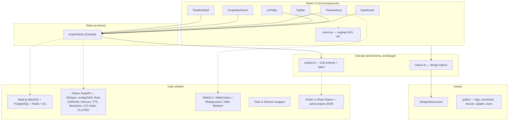

# Vidora — Architecture (Phase 2, v0.3.0)

## Principles (SPEC Section 2)

- **Non-destructive**: a project is a JSON document (tracks, clips, effects,
  keyframes, markers). Source media is never modified.
- **Command pattern**: every edit is a command — unlimited undo/redo
  (stacks exist in Phase 0; commands land in Phase 1).
- **Autosave + crash recovery**: Phase 1 (every few seconds).
- **Plugin registries**: effects, transitions, filters, stickers, fonts,
  templates and AI providers load from `manifest.json` (Phases 5–7).
- **Typed schemas**: Zod validates every project document; TypeScript types
  are derived from the schemas (single source of truth).

## Module diagram



## Folder tree (Phase 2, v0.3.0)

New in Phase 2: `src/lib/keyframes.ts` (easing solver, interpolation, animation
presets), `effects.ts` (14-effect catalog, CSS + pixel pipeline), `lut.ts`
(.cube parsing, trilinear sampling, 3 built-in looks), `color.ts` (curves,
wheels, HSL, sharpen), `masks.ts` (mask geometry, chroma key, layouts),
`transitions.ts` (8 transitions, canvas drawing), `scopes.ts` (histogram,
waveform, vectorscope), `compositor.ts` (per-frame canvas pipeline);
`src/components/KeyframesPanel.tsx`, `EffectsPanel.tsx`, `TransitionsPanel.tsx`,
`ColorPanel.tsx`, `ScopesPanel.tsx`, `MaskPanel.tsx`; `PreviewArea` rewritten
around the compositor (transitions, PiP/split, backgrounds, pen-mask clicks).
Schema is v0.3.0 with v0.1.0/v0.2.0 migration (`migrateProject`).

## Folder tree (Phase 1, v0.2.0)

New in Phase 1: `src/lib/` (timeline ops, media probing, shortcuts, exporter),
`src/components/MediaBrowser.tsx`, `ExportPanel.tsx`, `ShortcutsPanel.tsx`;
`TimelineShell`, `PreviewArea`, `PropertiesPanel`, `Dashboard`, `TopBar` and
`App` are now real editing surfaces (see README). Schema is v0.2.0 with
v0.1.0 migration (`migrateProject`).

## Folder tree (Phase 0)

```
vidora/
├── design/tokens.json
├── docs/ARCHITECTURE.md
├── LICENSES/
│   ├── LICENSE            # MIT
│   └── PROVENANCE.md
├── public/
│   ├── favicon.svg  logo.svg  logo-dark.svg  logo-light.svg
│   ├── splash.svg   wordmark.svg
│   └── icons/icon-{16,32,48,192,512}.svg
├── scripts/build-assets.mjs
├── src/
│   ├── App.tsx  main.tsx  index.css
│   ├── components/  Dashboard, TopBar, LeftTabs, PreviewArea,
│   │                PropertiesPanel, TimelineShell, icons.tsx
│   ├── design/tokens.ts
│   ├── schema/project.ts
│   ├── store/projectStore.ts
│   └── test/  projectSchema.test.ts  tokens.test.ts
├── index.html  package.json  tsconfig.json  vite.config.ts
├── README.md  SPEC.md  CHANGELOG.md
└── .gitignore
```

## Project JSON schema (v0.3.0; v0.1.0/v0.2.0 documents migrate)

Clips now also carry `adjustment` (brightness, contrast, saturation, exposure,
highlights, shadows, temperature, tint, hue, sharpen, curves, HSL, lift/gamma/
gain wheels, blendMode, denoise, `stabilization`/`lensCorrection` flags),
`animationIn`/`animationOut`, `transitionIn`, `lut` (length-validated,
size³×3), `mask` (shape, points, feather, invert), `chromaKey`, `layoutMode`/
`layoutSlot`, `background`. Keyframes gained `id` + optional bezier control
points; easing is linear/ease/ease-in/ease-out/bezier.

## Project JSON schema (v0.2.0; v0.1.0 documents migrate)

Clips now carry `mediaId`, `sourceStart`, `sourceDuration`, `speed` (0.1–100),
`reversed`, `frozen`, `rotation`, `flipH`/`flipV`, `scale`, `positionX`/`positionY`,
`fit`, `crop`, `groupId`, `compoundId`, `isCompound`, `pitchPreserved`, `volume`.
Projects carry `media[]` (MediaItem: kind, mime, size, duration, dimensions,
thumbnail, folderId, src) and `folders[]`, plus optional `customRatio`.

## Project JSON schema (v0.1.0)

Top-level document (`src/schema/project.ts`):

| Field | Type | Notes |
|---|---|---|
| `id` | string | unique project id |
| `name` | string (1–120) | display name |
| `version` | `"0.1.0"` | literal — documents are versioned |
| `aspectRatio` | `9:16 \| 16:9 \| 1:1 \| 4:5 \| 21:9 \| custom` | |
| `resolution` | `{ width, height }` | positive ints |
| `fps` | int 1–120 | |
| `tracks` | Track[] | video / audio / text |
| `markers` | Marker[] | `{ time, label, color #RRGGBB }` |
| `createdAt` / `updatedAt` | ISO datetime | |

Track → Clip → Effect / Keyframe. Clips carry `start`, `duration` (> 0),
`opacity` (0–1), optional `src` (never mutated), `effects[]`, `keyframes[]`.
Schema changes are additive only — old documents keep validating.

## Dependency list (Phase 0, installed)

| Package | Version | Role |
|---|---|---|
| react / react-dom | ^19 | UI |
| zustand | ^5 | store |
| zod | ^3 | schema validation |
| vite | ^6 | build/dev |
| @vitejs/plugin-react | ^4 | React Fast Refresh |
| tailwindcss / @tailwindcss/vite | ^4 | styling |
| typescript | ^5 | types |
| vitest | ^3 | tests |

Planned later (not installed in Phase 0): WebGL2/WebGPU rendering,
WebCodecs, ffmpeg.wasm, Web Audio API, NestJS, PostgreSQL, Redis,
S3-compatible storage, FastAPI AI service, Tauri/Electron, Docker,
GitHub Actions CI/CD.

## Rendering / media pipeline (planned, Phases 1–2)

```
import → proxy media → timeline (project JSON) → preview (WebGL2 compositor,
OffscreenCanvas, GLSL shaders, Web Audio) → export (WebCodecs, ffmpeg.wasm fallback)
```
